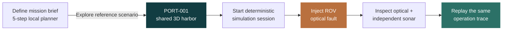
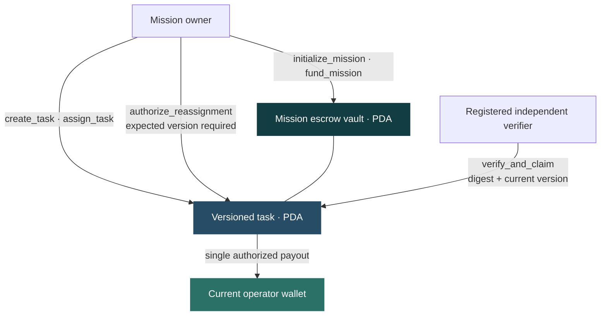
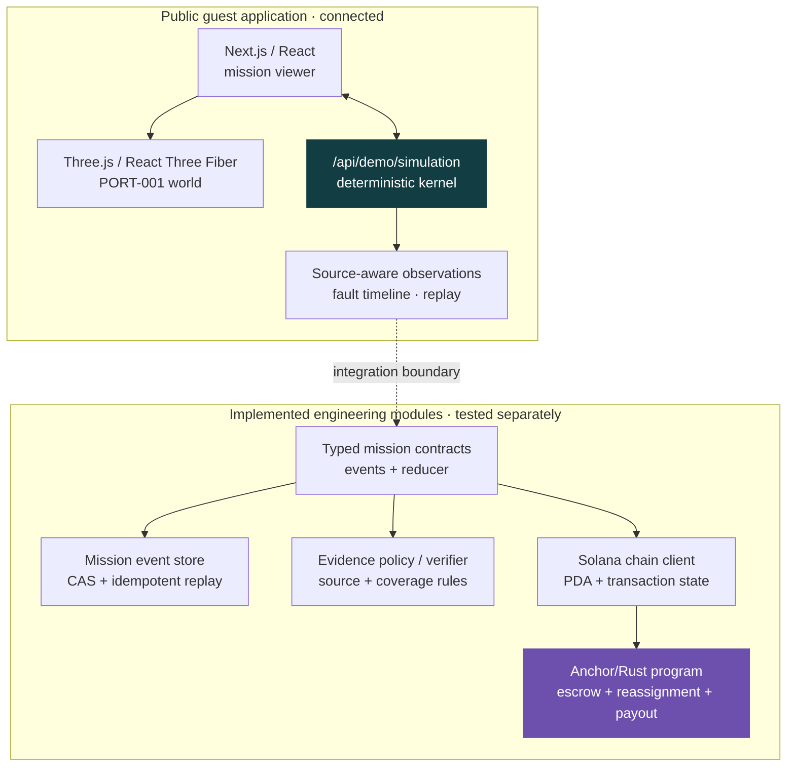

<div align="center">

# VORQYN

### Autonomous work. Accountable outcomes.

**A mission control and economic coordination layer for independently operated robots.**

Plan the job. Observe the machines. Understand a failure. Preserve the evidence.  
Build toward settlement that rewards **verified work—not merely a claim of completion.**

[**▶ Watch the demo**](https://youtu.be/5LzJXEW5Eas) &nbsp;·&nbsp; [**Explore the 3D harbor**](https://vorqynweb-production.up.railway.app/demo/mission) &nbsp;·&nbsp; [**Plan a mission**](https://vorqynweb-production.up.railway.app/workspace/create)

[](https://github.com/CosmasMandikonza/Vorqyn/actions/workflows/ci.yml) &nbsp;  &nbsp; 

[](https://youtu.be/5LzJXEW5Eas)

*Built for the November 2026 Solana × MLH Hackathon.*

</div>

---

## The missing layer between autonomy and trust

A storm damages a port. A drone can inspect overhead structures, a ground rover can assess access routes, and an underwater ROV can map submerged obstructions. But when these machines are operated by different providers, **who owns the mission, who decides whether the evidence is good enough, and who gets paid when conditions change?**

Most robotics software focuses on controlling a machine. VORQYN explores the layer *around* the machine: a shared operational world, source-aware observations, reproducible evidence, and programmable financial rules for a multi-operator mission.

| The operational challenge | The VORQYN approach |
| --- | --- |
| Different robots operate in disconnected interfaces | One spatially aligned, interactive mission world |
| A sensor can fail while the robot still appears to be working | Measured fault effects, independent sensors, and an inspectable timeline |
| An operator needs to investigate what happened | Source-labelled observations and deterministic replay |
| Multiple businesses need enforceable task ownership and payments | Solana Anchor escrow, versioned reassignment, and verifier-authorized payout rules |

**The idea:** physical execution stays off-chain; **financial authority belongs in a transparent, constrained protocol.**

## Experience the working demo

The public demo is an interactive **synthetic** inspection of a fictional port. The controls drive a deterministic simulation kernel through a real server API; the failure is reflected in sensor measurements, not just a visual effect.

| Step | Try it | What it demonstrates |
| --- | --- | --- |
| **01 · Define** | [Open mission builder](https://vorqynweb-production.up.railway.app/workspace/create) | Five-step planning: objective, environment, capabilities, evidence rules, and exact proposed SOL budget |
| **02 · Explore** | [Enter the harbor](https://vorqynweb-production.up.railway.app/demo/mission) | Aerial, ground, and underwater inspection in a shared ENU-coordinate world |
| **03 · Operate** | Click **Start synthetic survey**, then **Advance +1 step** | Kernel-observed robot positions, session state, and sequence timeline |
| **04 · Break** | Select **Inspection ROV** → **FOLLOW** → **Inject underwater optical fault** | Genuine simulated optical degradation while sonar remains independently observable |
| **05 · Investigate** | Advance, inspect the quality timeline, then click **Replay history** | Source-aware measurements, recorded pre/post-fault paths, and identical deterministic replay |

**[Watch the recorded walkthrough →](https://youtu.be/5LzJXEW5Eas)**

### The guest experience, end to end



*The builder saves a separate browser-local mission brief. “Explore” opens the independently running PORT-001 reference scenario, not a funded execution of that saved draft.*

## Why Solana belongs in VORQYN

A normal database can display **“task complete.”** A smart-contract protocol can constrain **who is authorized to change an assignment, how much has been reserved, and whether a reward can be paid twice.** Those are different responsibilities—and the reason we built a custom Anchor program rather than adding a wallet button to a robotics UI.

The [Anchor/Rust program](programs/vorqyn/src/lib.rs) implements:

- **Mission escrow:** initialize missions, fund a program-controlled vault, reserve bounded task rewards, and return eligible unused funds on close.
- **Ownership and reassignment:** assign an operator wallet, then authorize a replacement with compare-and-set assignment versions. Stale assignment requests cannot silently overwrite a newer owner decision.
- **Independent verifier authority:** registry-managed verifier identities and policy versions, with authorization checked before an acceptance can release funds.
- **Single-use payout:** `verify_and_claim` binds the claim to the current assignment, evidence digest, authorized verifier, and designated recipient; repeated and stale claims are rejected.
- **Exact accounting:** integer lamports, checked arithmetic, bounded reservations, and safe terminal states.

### How the on-chain contract works



This is **implemented Anchor program behavior exercised in local Solana execution tests**, including negative cases. It is **not** a claim that the public web demo funds an escrow or that the program has a verified devnet settlement history. The deployment procedure and proof requirements are documented in [the devnet runbook](docs/release/DEPLOYMENT_RUNBOOK.md).

| Failure / attack | Contract-level protection |
| --- | --- |
| Two actors attempt competing reassignments | Compare-and-set `expected_assignment_version` |
| Old operator submits evidence after reassignment | Version-bound claim eligibility |
| Payout is submitted twice | Terminal paid state and one-time claim guards |
| Unrelated wallet attempts to authorize evidence | Registered verifier / authority checks |
| Payment exceeds agreed task or escrow budget | Bounded reward and checked lamport accounting |

Read the [Solana protocol and threat model](docs/SOLANA_PROTOCOL.md), [account and instruction specification](programs/vorqyn/ACCOUNTS.md), and [LiteSVM integration tests](programs/vorqyn/tests/litesvm_escrow.rs).

## Architecture: machines off-chain, economic rights on-chain

VORQYN deliberately separates fast physical observation from financial authority. The browser does not need a blockchain transaction for every sensor reading. The smart contract does not pretend to determine whether a real underwater inspection was successful.



**The core trust boundary:** simulated telemetry carries its source label; evidence policy evaluates measurements; financial authority is enforced separately. The public guest journey currently exercises the simulation and replay path, while the mission-event, verifier, chain-client, and Anchor modules have separate code and tests. Integrating these modules into authenticated, funded customer missions is the next product milestone.

### What's already in the repository

| Module | What it contains |
| --- | --- |
| [`apps/web`](apps/web) | Public landing, five-step mission planner, interactive 3D harbor, fault controls, and 2D fallback |
| [`services/simulation`](services/simulation) | Deterministic inspection kernel and coordinate-aligned observations |
| [`assets/port-world`](assets/port-world) | Original fictional harbor geometry, routes, zones, and world metadata |
| [`packages/contracts`](packages/contracts) | Typed IDs, source provenance, mission events, exact lamports, reducer and replay fixtures |
| [`services/mission/orchestration`](services/mission/orchestration) | Append-only event store, compare-and-set protection, idempotency and file-backed local replay |
| [`services/verifier`](services/verifier) | Versioned policy and evidence-evaluation logic |
| [`packages/chain-client`](packages/chain-client) | Typed Solana account/PDA logic and transaction lifecycle handling |
| [`programs/vorqyn`](programs/vorqyn) | Custom Anchor program implementing escrow, assignments, verifier controls and claims |

## What the failure scenario proves

The standout interaction is intentional: **we damage the sensing conditions, not the credibility of the measurements.**

The underwater optical-visibility command is applied inside the deterministic simulation. Subsequent observations record degradation in optical quality; sonar remains a separate modality. The inspector exposes the source, simulator clock, trace sequence and measurement timeline. **Replay history** re-executes the trace and checks that the snapshots match.

Ghost Replay visualizes **recorded pre-fault and post-fault paths**. Those paths are not an invented recovery robot or evidence of a completed reassignment. This distinction matters: a credible autonomous-systems platform must make uncertainty and provenance visible instead of drawing a reassuring animation.

## Built for engineers, designed for operators

- A shared, navigable 3D harbor with calibrated camera stations: **AIR / LAND / UW / FOLLOW / INSPECT**.
- A quick **World Dive** camera journey and a fault timeline that makes degraded measurements readable.
- A **2D/no-WebGL alternative** that preserves source-labelled spatial information.
- Browser-local mission drafts with precise, validated SOL-to-lamport conversion and reload persistence.
- Deterministic APIs, typed state transitions, versioned policies and adversarial tests.
- An accessible light/dark interface rather than a generic crypto dashboard.

## Run it locally

**Requirements:** Node.js `22.21.1`, pnpm `10.34.5`, and Git. Windows developers can use WSL2 for the Solana/Rust toolchain.

```bash
git clone https://github.com/CosmasMandikonza/Vorqyn.git
cd Vorqyn
corepack enable
pnpm install --frozen-lockfile
pnpm dev:web
```

Open `http://localhost:3000` and choose **Explore Demo**, or go directly to `/demo/mission` and `/workspace/create`.

```bash
# JavaScript/TypeScript quality gates
pnpm lint
pnpm typecheck
pnpm test
pnpm build

# Deterministic kernel, coordinate integration, and port assets
node --test services/simulation/core/*.test.mjs
node --test services/simulation/integration/*.test.mjs
node assets/port-world/tools/validate.mjs --selfcheck
```

The [GitHub Actions workflow](.github/workflows/ci.yml) also builds the Solana SBF program and runs Rust/LiteSVM tests. Installing the Solana/Anchor tooling for separate program development requires additional setup; see the [program documentation](programs/vorqyn/ACCOUNTS.md) and [deployment runbook](docs/release/DEPLOYMENT_RUNBOOK.md).

## Delivery, evidence and next milestone

| Layer | Demonstrated state |
| --- | --- |
| Public 3D harbor and real synthetic fault/replay | **Interactive hosted demo** |
| Five-step mission configuration | **Working browser-local drafts** |
| Versioned mission events, verifier policy and chain client | **Implemented/tested modules** |
| Solana escrow, reassignment and payout invariants | **Anchor program + local SBF/LiteSVM tests** |
| Authenticated organizations, live robot telemetry and browser-to-chain settlement | **Next integration milestone** |

A public link, repository tests and a smart-contract implementation are three different forms of proof. We show each on its own terms. See the [release evidence](docs/release/README.md), [quality gates](docs/QUALITY_GATES.md), and [completed pull requests](https://github.com/CosmasMandikonza/Vorqyn/pulls?q=is%3Apr+is%3Amerged) for the engineering record.

### Where this can go

Ports are the first setting, not the whole market. The same separation of **mission definition → physical evidence → authorized settlement** could serve infrastructure inspectors, robotics service providers and other fleets that cross business boundaries. Our next step is to connect authenticated mission records, independently evaluated evidence and actual devnet-backed financial lifecycle—with inspectable receipts and no ambiguity about what was simulated versus settled.

---

<div align="center">

**VORQYN — autonomous work deserves accountable outcomes.**

[Watch the demo](https://youtu.be/5LzJXEW5Eas) · [Launch the 3D harbor](https://vorqynweb-production.up.railway.app/demo/mission) · [Read the protocol](docs/SOLANA_PROTOCOL.md)

</div>